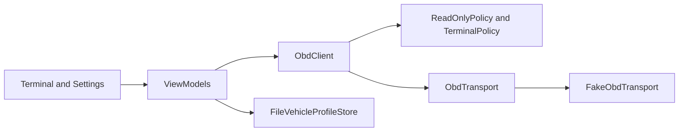

# Knackered OBD

Personal-use Android app, written in Kotlin with Jetpack Compose, for talking to an ELM327 or STN-based Bluetooth OBD-II adapter. The aim is live data and stored fault codes on any OBD-II compliant vehicle. It is not finished: the phone build can open a raw terminal and edit vehicle profiles, using a scripted stand-in adapter. It does not yet connect to Bluetooth.

## Features

What works today:

- A transport interface, with a scripted `FakeObdTransport`. Classic Bluetooth and BLE are not implemented.
- ELM setup and response parsing in the core library: init (`ATZ`, `ATE0`, `ATL0`, `ATS0`, `ATH0`, `ATSP0`), Mode 01 PID formulas, and Mode 03 decoding to P/C/B/U. Covered by unit tests, not by a live-data screen.
- A terminal screen. It sends one AT command or a Mode 01, 02, 03, or 09 request, shows the raw reply, and keeps a scrollable history. Mode 04 and anything else are refused before they are written, with a reason.
- An in-memory raw traffic log used by the session. There is no log screen.
- Vehicle profiles, stored in an app-private text file. Settings can create, select, edit, and delete profiles. Generic cannot be deleted. Each profile holds a name, optional year, fuel type, rev limit, redline, coolant warning and critical temperatures, speed maximum, and which of the six live PIDs to poll.

Not built, so not listed as features: Bluetooth connect, a live dashboard, gauges, a fault-code screen, simulation with varying values, and a poll scheduler.

## Screenshots

No screenshots are in the repo yet. Replace these lines when you have captures:

- Terminal: `docs/screenshots/terminal.png`
- Settings: `docs/screenshots/settings.png`

## Supported vehicles

Standard Mode 01 PIDs and generic fault codes are the ones most cars expose: roughly model year 1996 in the US, 2001 for EU petrol, and 2004 for EU diesel. What actually answers depends on the vehicle, the engine, and the adapter. Nothing in this table is a claim that a car works. Add a row only after you have tried it.

| Vehicle | Year | Engine | Adapter | Bluetooth type | Protocol | Status |
| --- | --- | --- | --- | --- | --- | --- |
| (none recorded) | | | | | | untested |

## Vehicle profiles

Profiles are not tied to one car. `VehicleProfile` holds the display limits and the PID list. `FileVehicleProfileStore` reads and writes `vehicle-profiles.txt` in the app files directory. A missing or unreadable file loads the built-in Generic profile: fuel unknown, no year, rev limit 7000 rpm, redline 6000 rpm, coolant warning 100 °C, critical 110 °C, speed maximum 200 km/h, and all six live PIDs. Those numbers are display defaults, not measurements.

`gaugeRanges()` is the only place a gauge should get its scale. There is no gauge screen yet, so Settings prints the scale it would use. Polling, when a dashboard exists, should use `pollPids()` from the selected profile rather than a fixed list in the UI.

## Architecture

`:obd-core` has no Android SDK dependency, so the parsers and session can be unit tested on the JVM. `:app` is the Compose UI. It currently opens `FakeObdTransport` itself. That wiring is temporary.

`ObdTransport` is connect, disconnect, write, and read-until-prompt. `ObdClient` serialises commands, appends the CR, waits for `>`, and parses the reply. PID objects carry the Mode 01 command, formula, and unit. The terminal and settings screens keep their state in ViewModels.



Classic SPP (RFCOMM UUID `00001101-0000-1000-8000-00805F9B34FB`) and BLE GATT are named on the transport interface. There are no implementations yet.

## Requirements and build

- JDK 17
- Kotlin 2.4.21, Gradle 9.1.0, Android Gradle Plugin 9.0.1
- An Android Studio release that can open an AGP 9.0 project
- min SDK 26, compile and target SDK 36

The app module needs an Android SDK. Put `sdk.dir` in `local.properties` (that file is gitignored). This checkout does not assume a particular SDK path.

```text
.\gradlew.bat :obd-core:test
```

To run on a device, open the project in Android Studio and run the `app` configuration. The launcher shows the terminal against the stand-in adapter, not the phone's Bluetooth radio. The manifest does not request Bluetooth permissions yet, because nothing scans or connects.

When Classic SPP is added, expect:

- Android 12 and newer: `BLUETOOTH_CONNECT` to use a paired adapter, and `BLUETOOTH_SCAN` if the app scans
- Older versions: `BLUETOOTH`, `BLUETOOTH_ADMIN`, and location permission for discovery

## Using it without a car

The current activity connects `FakeObdTransport` with a fixed demo script (not a recording from a car). From the terminal, `ATI` returns an ELM identity line, `010C` returns the sample RPM frame `41 0C 1A F8` (1726 rpm), and `03` returns two sample codes. `04` is refused and is not written.

There is no simulation mode with smoothly changing values. That is still to be built.

Unit tests live in `:obd-core` and do not need a device:

```text
.\gradlew.bat :obd-core:test
```

## Safety and scope

The session is read-only apart from Mode 04, which clears stored fault codes. The terminal cannot send Mode 04. `clearStoredDtcs()` is the only method that can, and it does not show a dialog itself. The caller is expected to confirm first. That confirmation screen is not built yet, and the method is not wired to the UI.

The app does not write coding or configuration to any ECU. UDS and manufacturer modules are out of scope. Use it at your own risk. Do not operate it while driving. This project is not affiliated with any vehicle or adapter manufacturer.

## References

Command and response handling was checked against [eltonvs/kotlin-obd-api](https://github.com/eltonvs/kotlin-obd-api). Bluetooth handling, when it is written, is intended to follow [barnhill/AndroidOBD](https://github.com/barnhill/AndroidOBD). Both are references only. Neither is a dependency.

## Roadmap

- Classic Bluetooth SPP, then a BLE GATT transport, with a Connect screen and the permissions above
- Live dashboard and Canvas gauges, using `gaugeRanges()` from the selected profile
- Poll scheduler: RPM and speed every cycle, other profile PIDs less often
- Fault-code screen, including a confirmation dialog before `clearStoredDtcs()`
- Simulation mode on `FakeObdTransport` (varying values and occasional `NO DATA`)
- Raw log screen and session export
- Terminal improvements beyond the current allow-list
- Read-only module scan. Still no coding, and no manufacturer-specific writes

## Contributing

To record a combination you have actually tried, open an issue or pull request and add a row to the table above: vehicle, year, engine, adapter, Bluetooth type (Classic or BLE), protocol string from the adapter, and status (`works`, `partial`, or `failed`, plus what failed). Do not mark a row tested unless you tried it.

## Licence

No licence file has been added yet. MIT is a reasonable choice for this project if you want to add one.
